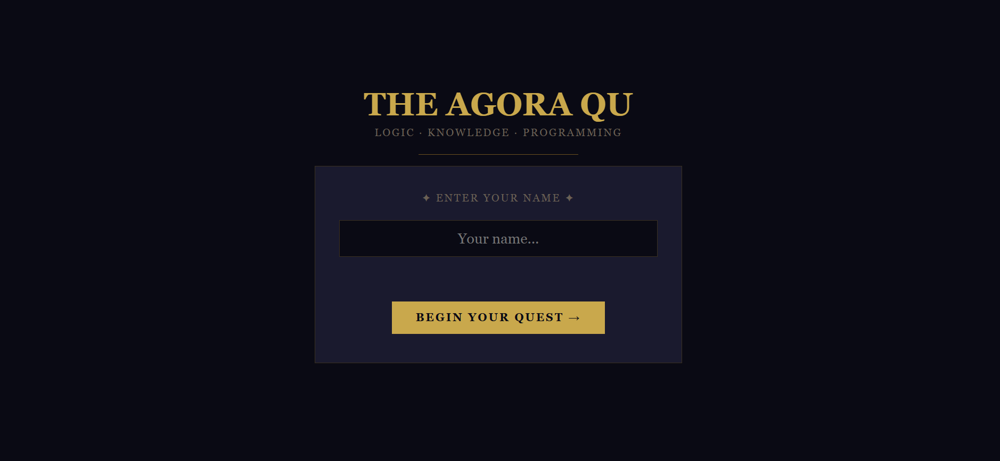
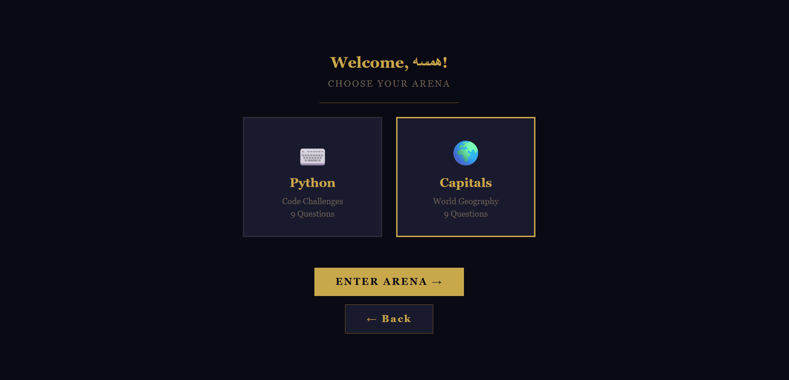
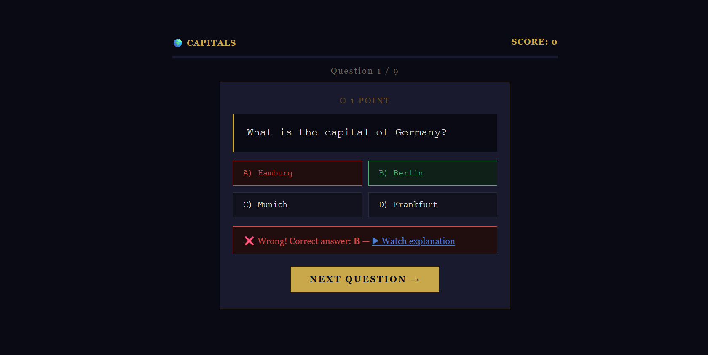
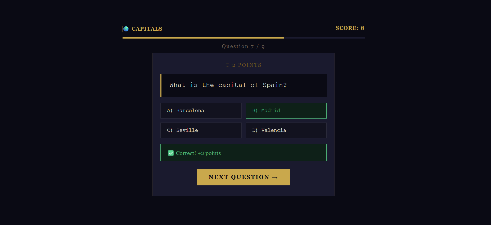
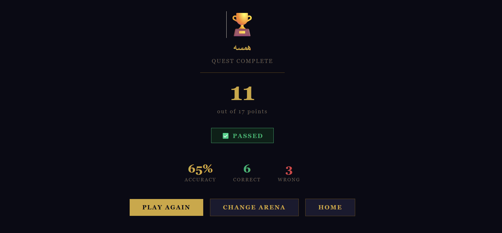

# The AGORA — Interactive Quiz Game

**The AGORA** is an interactive quiz game built around two knowledge arenas: **Python programming** and **World Capitals**. Players enter a name, choose an arena, answer multiple-choice questions, and receive feedback and a final performance summary.

The project includes a browser-based version and a Python desktop version.

## Play Online

The browser version is provided in `index.html`.

> **GitHub Pages:** Enable Pages in **Settings → Pages**, select **Deploy from a branch**, then choose branch `main` and folder `/(root)`. Once deployment is complete, the game should be available at:
>
> https://hamsa-elasaal.github.io/The-AGORA/

## Screenshots — Web Version

### 1. Welcome Screen
The player enters a name before starting the quiz.



### 2. Arena Selection
Players choose between the Python programming arena and the World Capitals arena.



### 3. Incorrect Answer Feedback
*Screenshot to be added — shows the feedback displayed after selecting an incorrect answer.*



### 4. Correct Answer Feedback
*Screenshot to be added — shows the feedback displayed after selecting the correct answer.*



### 5. Final Results
*Screenshot to be added — shows the player's final score and quiz results.*



## Features

- Player name entry and welcome screen.
- Two quiz arenas: **Python** and **World Capitals**.
- Multiple-choice questions.
- Randomized question order.
- Immediate feedback after answering.
- Score tracking and quiz progress.
- Final results at the end of a quiz.
- Options to play again or choose another arena.

## Technologies

- **Python** — desktop application logic.
- **Tkinter** — graphical user interface for the desktop version.
- **HTML, CSS and JavaScript** — browser-based version.

## Run the Python Desktop Version

1. Install Python 3.
2. Clone or download this repository.
3. Open a terminal in the project directory.
4. Run:

```bash
python agora_quiz.py
```

If Tkinter is not included in your Python installation, install the Tk support package for your operating system.

## Repository Structure

```text
The-AGORA/
├── agora_quiz.py       # Python desktop game
├── index.html          # Browser-based game
├── screenshots/
│   ├── 01-welcome-screen.png
│   ├── 02-arena-selection.png
│   ├── 03-incorrect-answer.png
│   ├── 04-correct-answer.png
│   └── 05-final-results.png
└── README.md
```

## Project Scope

The game is an educational project focused on programming knowledge and general geography. It is designed for individual play sessions; persistent user accounts, a database, and online leaderboards are not part of the current implementation.

---

*The AGORA — Logic · Knowledge · Programming*
